# Análise de Compras Públicas Federais (PNCP) — Esteira Analítica End-to-End

Projeto avaliativo do Módulo 2 (Análise de Dados com Python e PostgreSQL).
Esteira completa: **dados brutos do PNCP → Python (auditoria e limpeza) → PostgreSQL (Star Schema) → Power BI (dashboard executivo)**.

**Projeto de Recuperação (Módulo 2).** Nesta entrega a defesa técnica é **escrita neste README** (seções 5 a 10), sem vídeo.

## 1. Contexto do problema

Uma consultoria de inteligência governamental atende órgãos de controle e transparência. A Controladoria identificou indícios de sobrepreço, concentração de contratos em poucos fornecedores, morosidade entre a publicação do edital e a homologação, e baixa competitividade em certas modalidades. Os dados de origem não têm validação na ponta: CNPJ com máscara, valores monetários em texto livre, datas em vários formatos e inconsistências de cronograma.

A base é o Portal Nacional de Contratações Públicas (PNCP), ano de 2025 completo (2.042 contratações, 7.077 itens e 15.896 resultados de fornecedores).

Perguntas de negócio respondidas (SQL em `sql/02_perguntas.sql` e dashboard em `powerbi/`): (1) economia global, (2) concentração de fornecedores, (3) eficácia por modalidade, (4) ciclo de compras por órgão, (5) distribuição regional, (6) perfil do gasto (bens, serviços, obras), (7) evolução mensal e sazonalidade, (8) sobrepreço, (9) micro e pequenas empresas e (10) órgãos e Poderes.

## 2. Estrutura do projeto

```
data/raw/        CSVs brutos fornecidos (compras, itens, resultados)
data/processed/  tabelas limpas geradas pelo Python (não versionadas)
src/             limpeza.py, montar_tabelas.py, carregar.py, banco.py, config.py, auditoria.py
sql/             01_criar_banco.sql e 02_perguntas.sql
powerbi/         dashboard_pncp.pbix
docs/img/        sprints.png, prints das 10 páginas do dashboard e demais imagens
docs/enunciados/ enunciado e tutorial da disciplina
```

## 3. Decisões técnicas

- **Tudo como texto na leitura (`dtype=str`)**: o pandas não "ajuda" e o CNPJ não perde o zero à esquerda antes da limpeza.
- **Limpeza em funções pequenas e testáveis** (`src/limpeza.py`), com autoteste de 54 casos (`python -m src.limpeza`).
- **Separadores numéricos**: nesta base, ponto ou vírgula sozinho é sempre decimal; só o símbolo repetido é milhar. Evita volume inflado em bilhões.
- **Um vencedor por item**: primeiro descartam-se os resultados cancelados, depois fica o 1º colocado (menor ordem, desempate pelo menor sequencial). Se o 1º estiver cancelado, o 2º assume.
- **Só itens com resultado entram na fato** (852 itens sem resultado ficam de fora).
- **Itens rejeitados (99)**: quantidade ≤ 0 ou vazia, valor unitário estimado ou homologado ausente/≤ 0, orçamento sigiloso, total estimado < R$ 1, homologado mais de 1.000× o estimado, ou qualquer total acima de R$ 1 trilhão.
- **Comparabilidade**: item não é Credenciamento e a razão homologado ÷ estimado está entre 0,1 e 10. A economia só conta itens comparáveis, e o percentual é soma ÷ soma (nunca média de percentuais).
- **Cronologia**: homologação anterior à publicação é impossível; o item fica na fato, sem data de homologação e sem ciclo.
- **Perfil do gasto**: `material_ou_servico` define Bens/Serviços; palavras-chave (`obra`, `construção`, `reforma`, `engenharia`, com limites de palavra `\b`) no item ou no objeto da compra definem "Obras e engenharia".
- **Banco como segunda barreira**: `CHECK`, `UNIQUE` e `DECIMAL`.
- **Power BI com importação**, calendário dinâmico em DAX, 22 medidas explícitas (tabela `Medidas`, uma pasta de exibição por pergunta), menu retrátil com bookmarks e páginas de tooltip.

## 4. Dicionário de inconsistências tratadas

Números obtidos pela auditoria (`python -m src.auditoria`).

| Desafio | Problema encontrado | Registros afetados | Tratamento |
|---|---|---|---|
| Documentos | CNPJ de órgão com máscara / com espaços nas pontas | 176 / 131 | mantém só dígitos, completa zeros (14 para PJ, 11 para PF) |
| Documentos | CNPJ/CPF de fornecedor com máscara / com espaços | 1.633 / 990 | idem, conforme `tipo_pessoa`; estrangeiros (PE) preservados |
| Documentos | CNPJ de órgão com 11, 12 ou 13 dígitos (zero perdido) | 77 | `zfill` até o tamanho correto |
| Dinheiro | Valores com `R$`, vírgula e ponto+vírgula misturados, espaços | ex.: 1.188 com `R$` em `valor_unitario_estimado` | `converter_numero` |
| Datas | 7 formatos diferentes no mesmo campo | `data_publicacao`: 7 formatos; `data_resultado`: 7 formatos | `converter_data` (2000–2030) |
| Nulos disfarçados | `N/A`, `-`, `0`, "Não se aplica" etc. | ex.: `categoria_item` 7.077; `porte` 4.893; `criterio_julgamento` 1.883; `modo_disputa` 967 | `eh_nulo` (o `0` só é nulo em texto) |
| Encoding | Texto UTF-8 lido como Latin-1 (`ç`, `ã`) | 173 em `objeto_compra`; 223 em `descricao`; 4 em `nome_fornecedor` | `consertar_acento` |
| Nomes | Mesmo órgão escrito de formas diferentes | 440 nomes distintos → 352 após padronizar | `padronizar_nome` (maiúsculas e espaços) |
| Regras | Resultados cancelados | 62 | descartados antes de escolher o vencedor |
| Regras | Itens com mais de um resultado (Registro de Preços) | 466 | um vencedor por item |
| Regras | Itens sigilosos | 54 | rejeitados |

## 5. Modelagem dimensional (Star Schema)

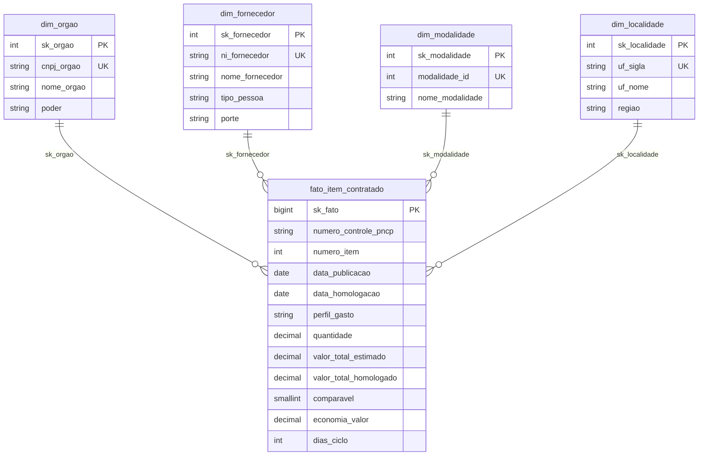

A fato tem uma linha por item de contratação (`numero_controle_pncp` + `numero_item`, único). O tempo é a tabela `Calendario`, criada em DAX no Power BI e relacionada a `data_publicacao` (ativa) e `data_homologacao` (inativa, usada com `USERELATIONSHIP`).

## 6. Tecnologias

Python 3.12 (pandas, psycopg2), PostgreSQL, SQL, Power BI Desktop (DAX), Git/GitHub.

## 7. Como reproduzir do zero

1. Clone o repositório e entre na pasta.
2. Crie o ambiente e instale as dependências:
   ```
   python -m venv .venv
   .venv\Scripts\Activate.ps1
   pip install -r requirements.txt
   ```
3. Copie `.env.example` para `.env` e preencha a senha do PostgreSQL.
4. Confira a limpeza: `python -m src.limpeza` (deve mostrar 54 de 54 exemplos certos).
5. Monte as tabelas: `python -m src.montar_tabelas` (imprime a conferência com a prova real).
6. Carregue o banco: `python -m src.carregar` (recria o banco, roda `sql/01_criar_banco.sql` e confere as contagens).
7. Rode as consultas de `sql/02_perguntas.sql` no pgAdmin.
8. Abra `powerbi/dashboard_pncp.pbix` e clique em **Atualizar**.

## 8. Resultados de conferência

| Indicador | Resultado |
|---|---|
| Itens na fato | 6.126 |
| Itens rejeitados | 99 |
| Fornecedores / órgãos (CNPJ) | 2.652 / 363 |
| Volume homologado | R$ 8.044.498.805,74 |
| Itens comparáveis | 5.457 |
| Economia | 14,46% |
| Ciclo médio / máximo | 48,1 / 611 dias |
| Itens sem ciclo | 230 |
| Perfil do gasto (volume) | Obras e engenharia 60,8% · Serviços 36,6% · Bens 2,6% |

## 9. Defesa escrita

### 9.1 Pipeline Python

A leitura é sempre `dtype=str`, para o pandas não converter nada antes da limpeza. Cada inconsistência tem uma função pequena e testável em `src/limpeza.py` (54 exemplos de autoteste: `python -m src.limpeza`).

**Documentos (CNPJ/CPF).** Deixa só dígitos e devolve os zeros da esquerda, porque a máscara e a conversão numérica corrompem o identificador. O tamanho vem do tipo de pessoa (PJ = 14, PF = 11); estrangeiros (PE) ficam como estão.

```python
digitos = "".join(c for c in texto if c.isdigit())
return digitos.zfill(tamanho)   # 14 para PJ, 11 para PF
```

**Dinheiro.** Nesta base, ponto ou vírgula sozinho é sempre decimal e só o símbolo repetido é milhar; quando aparecem os dois, o último é o decimal. Isso evita o erro clássico de ler `0,754` ou `746.815` como milhar, que inflaria o volume para R$ 31 bi em vez de R$ 8 bi. Valores entre parênteses ou com `-` viram negativos, e o `0` é um número válido (só vira nulo em campos de texto).

```python
if "." in texto and "," in texto:
    if texto.rfind(",") > texto.rfind("."):
        texto = texto.replace(".", "").replace(",", ".")   # 1.234,56
    else:
        texto = texto.replace(",", "")                     # 1,234.56
```

**Datas.** Há 7 formatos no mesmo campo; `converter_data` testa cada um e aceita só 2000–2030. Homologação anterior à publicação é impossível: o item **continua na fato**, mas sem `data_homologacao` e sem `dias_ciclo` (230 itens).

**Um vencedor por item.** A ordem importa: primeiro descartam-se os resultados cancelados (`data_cancelamento` preenchida) e só depois fica o 1º colocado, com desempate pelo menor `sequencial_resultado`. Assim, se o 1º está cancelado, o 2º assume (sem isso faltariam cerca de 60 itens).

```python
resultados = resultados[~resultados["cancelado"]].copy()
resultados = resultados.sort_values(["numero_controle_pncp", "numero_item", "ordem", "sequencial"])
resultados = resultados.drop_duplicates(["numero_controle_pncp", "numero_item"])
```

**Rejeição e comparabilidade.** São rejeitados 99 itens com dados impossíveis (motivos na seção 3). Já a comparabilidade (`comparavel = 1`) exclui Credenciamento e razões homologado ÷ estimado fora de 0,1–10, porque misturar esses itens levaria a economia de 14,46% para algo como 75%.

### 9.2 Modelagem no PostgreSQL

- **Grão da fato:** um item de contratação (`numero_controle_pncp` + `numero_item`), com o fornecedor vencedor. 6.126 linhas.
- **Dimensões:** `dim_orgao` (quem comprou, 1 linha por CNPJ de unidade), `dim_fornecedor` (quem vendeu), `dim_modalidade` (como comprou) e `dim_localidade` (UF e região). O tempo é o `Calendario` em DAX.
- **Chaves:** toda tabela tem PK substituta (`sk_*`); as dimensões guardam a chave natural como `UNIQUE` (`cnpj_orgao`, `ni_fornecedor`, `modalidade_id`, `uf_sigla`); a fato tem 4 FK `NOT NULL` e `UNIQUE (numero_controle_pncp, numero_item)`.
- **CHECK:** quantidade > 0, valores ≥ 0, `comparavel` em (0, 1) e `dias_ciclo` ≥ 0. O banco é a segunda barreira depois do Python.
- **Linha "Não informado" (sk = -1):** **não foi necessária**. Todo item da fato tem órgão, fornecedor, modalidade e UF, e as FK são `NOT NULL`. A consulta de FK solta abaixo comprova.
- **Tipos:** dinheiro em `DECIMAL(18,2)` e preços unitários e quantidades em `DECIMAL(18,4)`. `FLOAT` guarda aproximações binárias e acumula erro de centavos ao somar milhares de linhas; `DECIMAL` é exato, e a soma do volume bate com a prova real ao centavo.

Consultas de conferência (resultado após `python -m src.carregar`):

```sql
SELECT 'fato_item_contratado' AS tabela, COUNT(*) FROM fato_item_contratado
UNION ALL SELECT 'dim_orgao', COUNT(*) FROM dim_orgao
UNION ALL SELECT 'dim_fornecedor', COUNT(*) FROM dim_fornecedor
UNION ALL SELECT 'dim_modalidade', COUNT(*) FROM dim_modalidade
UNION ALL SELECT 'dim_localidade', COUNT(*) FROM dim_localidade;

-- FK solta (deve ser 0 nas quatro)
SELECT COUNT(*) FROM fato_item_contratado f LEFT JOIN dim_orgao d USING (sk_orgao) WHERE d.sk_orgao IS NULL;
-- (idem para dim_fornecedor, dim_modalidade e dim_localidade)
```

| Tabela | Linhas | Esperado |
|---|---|---|
| fato_item_contratado | 6.126 | 6.126 |
| dim_orgao | 363 | 363 |
| dim_fornecedor | 2.652 | 2.652 |
| dim_modalidade | 7 | 7 |
| dim_localidade | 27 | 27 |
| **FK solta (órgão, fornecedor, modalidade, UF)** | **0 / 0 / 0 / 0** | 0 |

### 9.3 Dashboard Power BI

O arquivo está em `powerbi/dashboard_pncp.pbix`. Cada página segue **pergunta → números → conclusão**, e os números são os mesmos de `sql/02_perguntas.sql`.

**Modelo, calendário e medidas**

**MODELO**
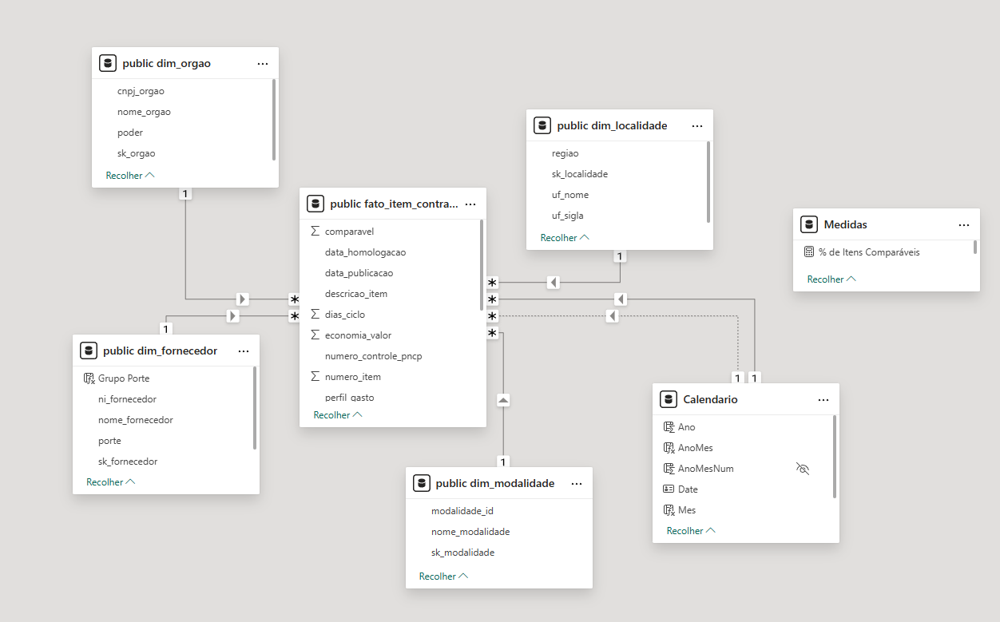

**CALENDÁRIO E ORDENAÇÃO**
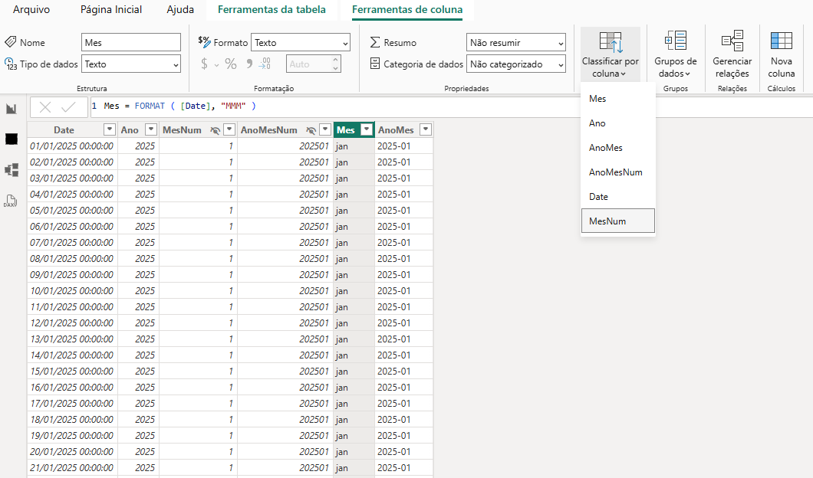
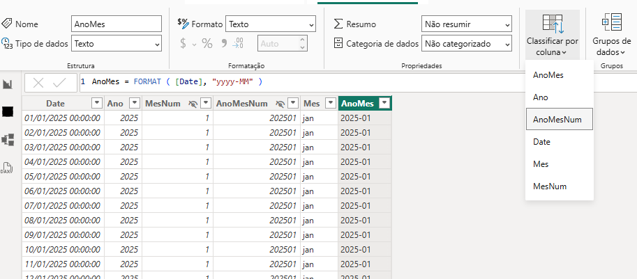
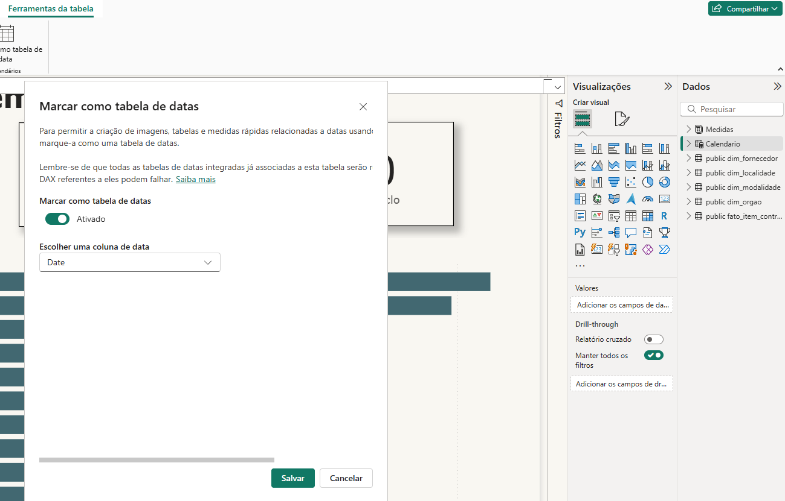


**TABELA DE MEDIDAS**
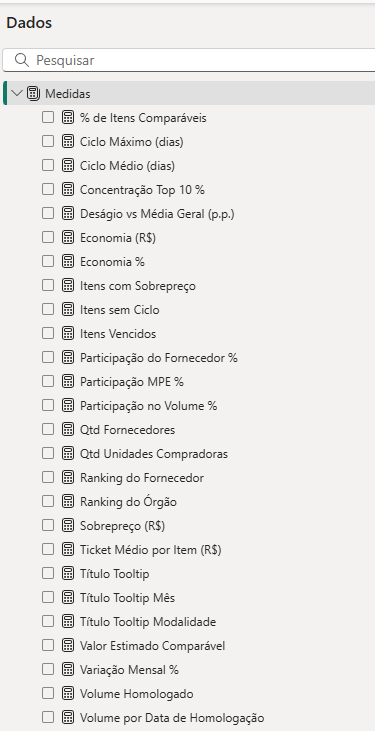

O `Calendario` é criado em DAX (`CALENDARAUTO`, limites vindos dos dados), com `Mes` ordenado por `MesNum` e `AnoMes` ordenado por `AnoMesNum`, marcado como tabela de datas e **relacionado à fato por duas datas**: `data_publicacao` (ativa) e `data_homologacao` (inativa, usada por `USERELATIONSHIP`). A hierarquia automática de datas está desligada.

**Navegação e tooltip**
**MENU ABERTO**
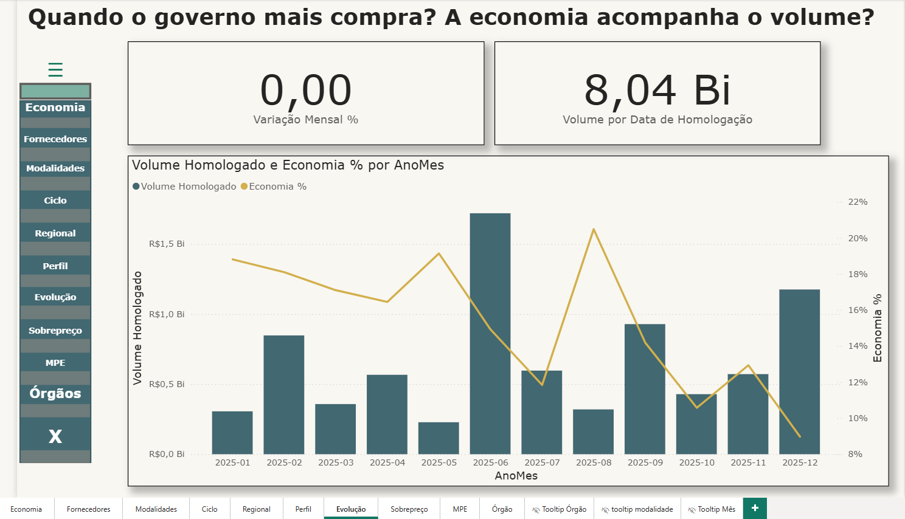

**MENU FECHADO**
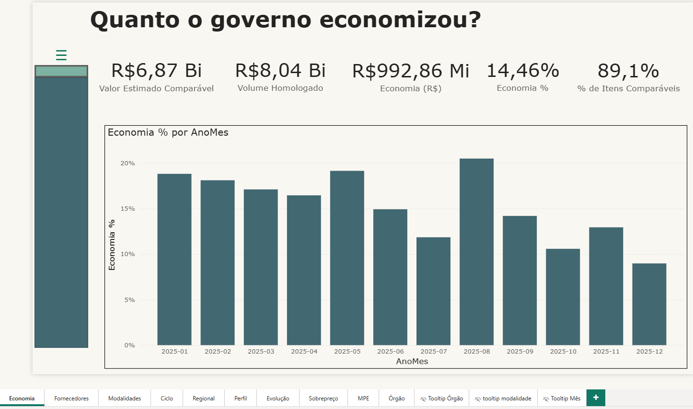

**TOOLTIP EM AÇÃO**
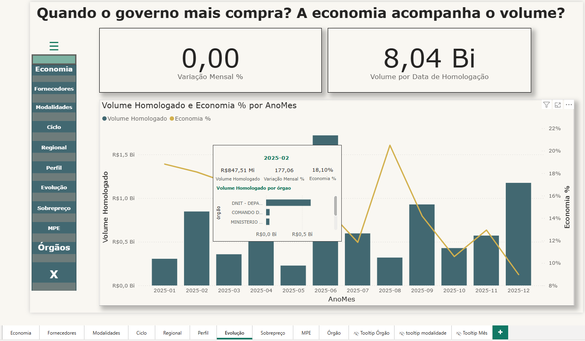

O menu retrátil usa dois bookmarks (menu aberto e menu fechado) acionados por botões. Os tooltips são páginas ocultas que, ao passar o mouse, mostram economia, volume, ciclo médio e a evolução mensal do órgão, da modalidade ou do mês sob o cursor.

**Páginas e conclusões**


**P1 — Economia.**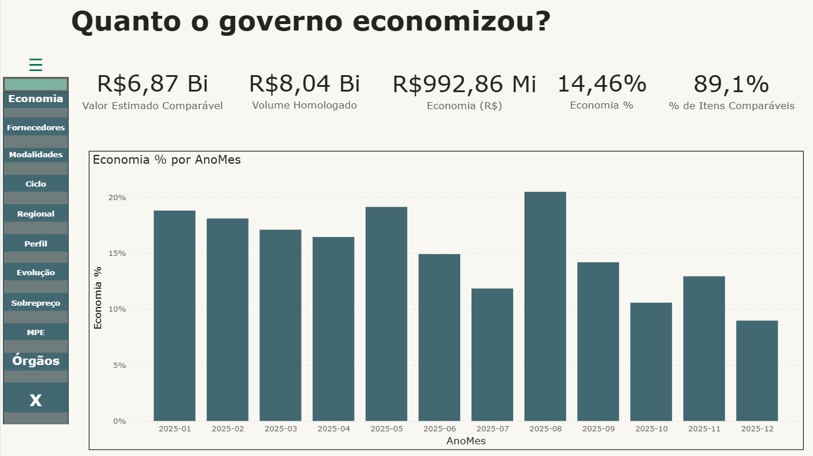
O governo economizou 14,46% na base comparável (R$ 992,86 Mi).

**P2 — Concentração de Fornecedores**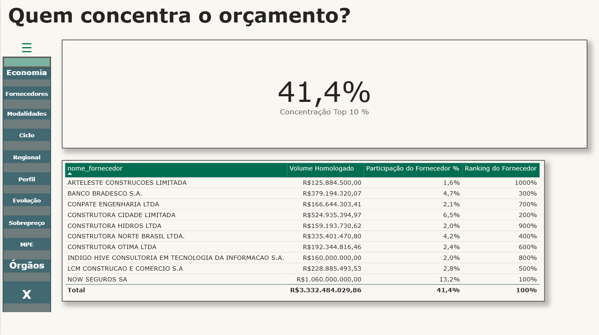
Há alto risco de concentração. **Apenas 10 empresas** (Top 10) dominam **41,4%** de todo o orçamento público homologado no período.

**P3 — Eficácia por Modalidade**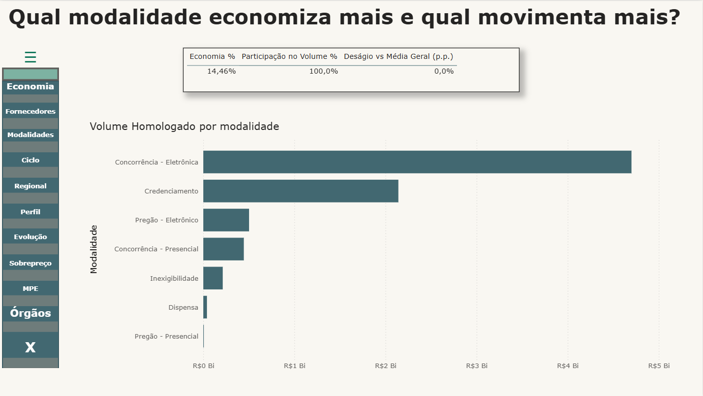
A Concorrência Eletrônica é a principal via de escoamento de verba. Modalidades sem disputa direta (Dispensa e Inexigibilidade) apresentam os piores deságios.

**P4 — Tempo do Ciclo de Compras**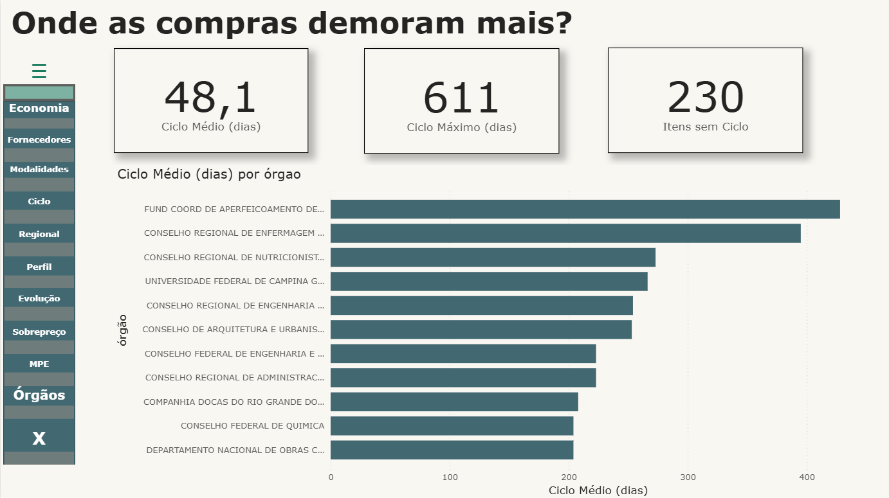
A morosidade é um problema grave. O ciclo médio é de **48,1 dias**, mas há órgãos atingindo picos alarmantes de até **611 dias** para homologar um edital.

**P5 — Distribuição Regional**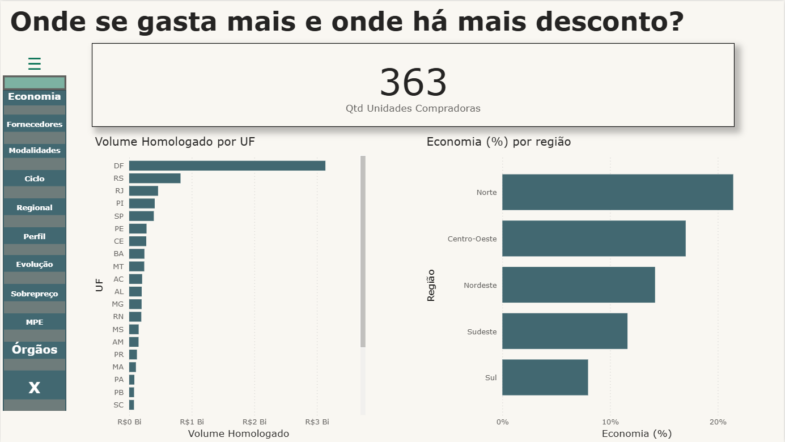
A despesa é fortemente centralizada nas regiões **Sudeste** e **Centro-Oeste**, acompanhando a localização sede dos principais Ministérios.

**P6 — Perfil dos Gastos**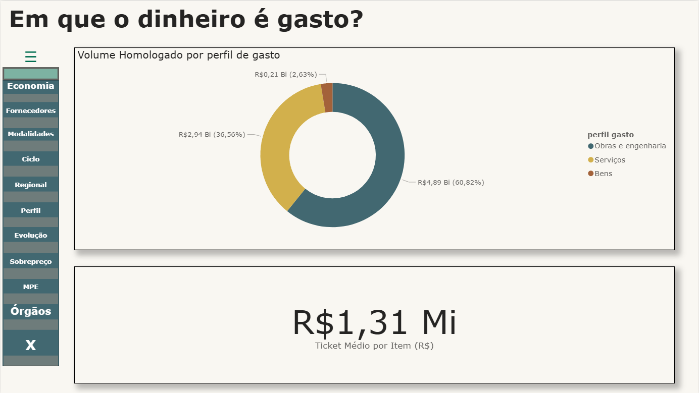
Obras e Engenharia dominam o volume financeiro (60,8%), seguidas de Serviços (36,6%). Bens representam apenas 2,6% do montante.

**P7 — Evolução mensal.** 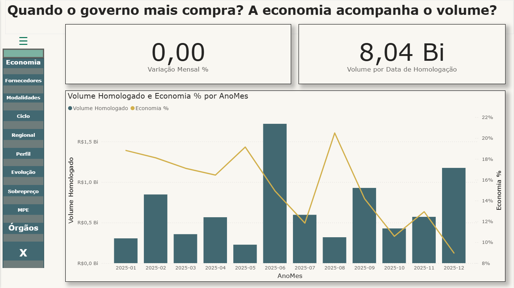
O volume é muito irregular: o pico é **jun/2025 (R$ 1,72 bi, 21,4% do ano)** e o menor mês é mai/2025 (R$ 228 mi). A economia % varia de **8,97% (dez)** a **20,49% (ago)** e não acompanha o volume: nos meses de pico (jun e dez) o desconto foi dos menores.

**P8 — Sobrepreço.** 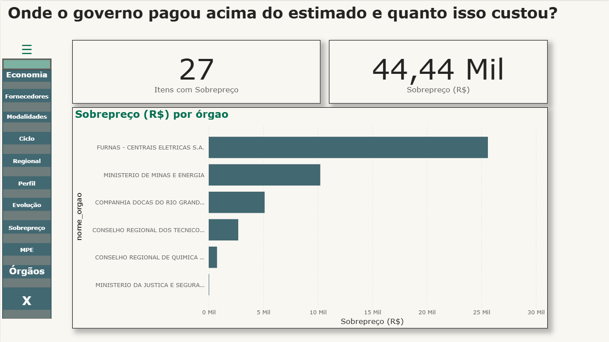
São **27 itens comparáveis** homologados acima do estimado, somando **R$ 44.440,34**. É raro (cerca de 0,5% dos itens comparáveis), mas concentrado: Furnas (14 itens) e Ministério de Minas e Energia (9 itens) respondem por cerca de 80% do valor.

**P9 — Micro e pequenas empresas.** 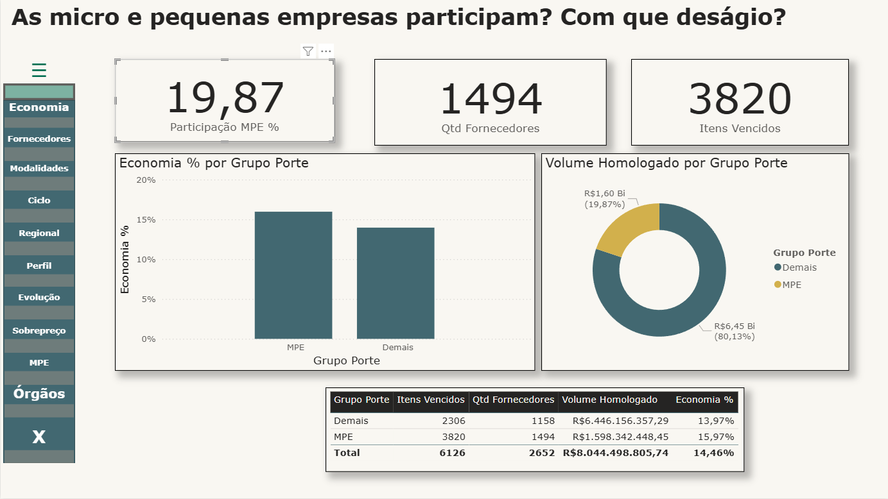
ME e EPP ficam com **19,87% do volume**, vencem **3.820 itens** (62% do total) e somam **1.494 fornecedores**. O deságio delas é **15,97%**, contra **13,97%** das demais, ou seja, 2,0 p.p. maior.

**P10 — Órgãos e Poderes.** 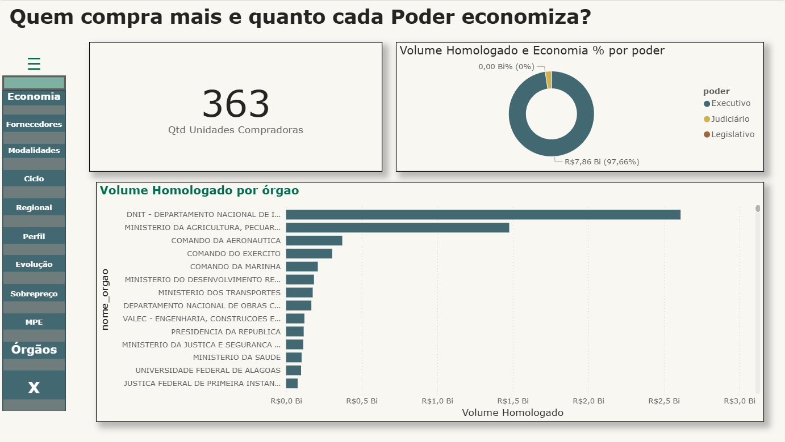
O DNIT concentra **R$ 2,61 bi (32,45%)** e os 10 maiores órgãos somam **71,29%** do volume. O Executivo tem **97,66%** do volume (350 unidades); Judiciário, 2,29%; Legislativo, 0,05%. A economia do Legislativo (21,57%) vem de uma base minúscula e não é comparável à do Executivo (14,54%).

### 9.4 Três medidas DAX explicadas

**1) Variação Mensal % (inteligência temporal)**

```DAX
Variação Mensal % =
VAR volumeAtual = [Volume Homologado]
VAR volumeAnterior =
    CALCULATE ( [Volume Homologado], DATEADD ( Calendario[Date], -1, MONTH ) )
RETURN
    DIVIDE ( volumeAtual - volumeAnterior, volumeAnterior )
```

- `VAR volumeAtual`: guarda o volume homologado do mês que está na linha do visual (contexto de filtro vindo do `Calendario`).
- `VAR volumeAnterior`: `CALCULATE` muda o contexto; `DATEADD(..., -1, MONTH)` desloca as datas filtradas um mês para trás, então a medida passa a enxergar o mês anterior.
- `RETURN DIVIDE(...)`: (atual − anterior) ÷ anterior, que é a variação percentual. `DIVIDE` devolve vazio se o anterior for zero ou vazio, por isso jan/2025 fica em branco.
- Exemplo: fev/2025 = +177,1%, jun/2025 = +654,1% sobre mai/2025.

**2) Concentração Top 10 % (TOPN + KEEPFILTERS)**

```DAX
Concentração Top 10 % =
VAR top10 = TOPN ( 10, ALL ( 'public dim_fornecedor' ), [Volume Homologado] )
VAR volumeTop10 = CALCULATE ( [Volume Homologado], KEEPFILTERS ( top10 ) )
VAR total = CALCULATE ( [Volume Homologado], ALL ( 'public dim_fornecedor' ) )
RETURN DIVIDE ( volumeTop10, total )
```

- `top10`: `TOPN` olha para **todos** os fornecedores (`ALL`) e fica com os 10 de maior volume.
- `volumeTop10`: `KEEPFILTERS` aplica essa lista como filtro sem apagar os outros filtros da página, então a soma respeita, por exemplo, uma segmentação de ano.
- `total`: volume de todos os fornecedores, ignorando o filtro de fornecedor.
- O `DIVIDE` entrega soma ÷ soma (nunca média de percentuais).

**3) Sobrepreço (R$) (iteradora + FILTER)**

```DAX
Sobrepreço (R$) =
VAR itens =
    FILTER (
        'public fato_item_contratado',
        'public fato_item_contratado'[comparavel] = 1
            && 'public fato_item_contratado'[valor_total_homologado]
                > 'public fato_item_contratado'[valor_total_estimado]
    )
RETURN
    SUMX ( itens, 'public fato_item_contratado'[valor_total_homologado]
                 - 'public fato_item_contratado'[valor_total_estimado] )
```

- `itens`: tabela virtual só com os itens **comparáveis** em que o homologado passou do estimado. Sem `comparavel = 1` seriam 60 itens, não 27.
- `SUMX`: iteradora; percorre cada item dessa tabela, calcula (homologado − estimado) linha a linha e soma. Resultado: R$ 44.440,34.

## 10. Planejamento em Sprints

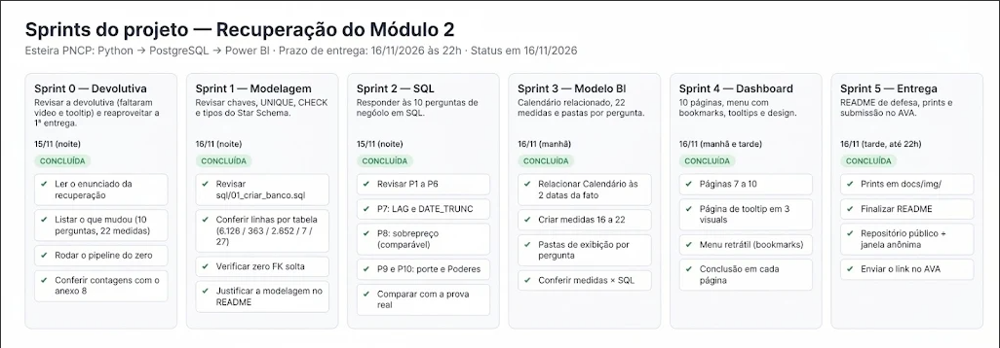

A recuperação foi dividida em 6 sprints, cada uma terminando com algo conferível na prova real:

| Sprint | Objetivo | Entrega conferida |
|---|---|---|
| 0 | Revisar a devolutiva (faltaram vídeo e tooltip) e reaproveitar limpeza, tabelas e carga da 1ª entrega | Pipeline roda do zero e as contagens batem com o anexo 8 |
| 1 | Revisar a modelagem (chaves, UNIQUE, CHECK, tipos) | Contagens corretas e zero FK solta |
| 2 | Perguntas 1 a 10 em SQL (novas: 7 a 10) | Resultados batem com a prova real |
| 3 | Power BI: relacionamentos do Calendário, 22 medidas e pastas | Medidas mostram os mesmos números do SQL |
| 4 | Power BI: 10 páginas, menu com bookmarks, tooltips e design | Cada pergunta tem página com números e conclusão |
| 5 | README de defesa, prints e figura das Sprints | O projeto é reproduzível só lendo o README |

### O que mudou em relação à 1ª entrega

- **Corrigido a partir da devolutiva:** removido o vídeo (defesa agora escrita) e adicionadas páginas de tooltip.
- Dashboard ampliado de 6 para **10 páginas**, e de 15 para **22 medidas**, com pastas de exibição por pergunta.
- Calendário agora relacionado às duas datas da fato (`data_publicacao` ativa e `data_homologacao` inativa) para suportar `USERELATIONSHIP`.
- Medida `Qtd Unidades Compradoras` passou a contar `sk_orgao` na fato, para respeitar filtros de UF, modalidade e perfil.
- `sql/02_perguntas.sql` ganhou as perguntas 7 a 10 (`LAG`, `DATE_TRUNC`, `CASE WHEN` por porte, `JOIN` com `dim_orgao`).
- Menu retrátil com bookmarks e organização de pastas (`docs/enunciados/`, `powerbi/`).

### Lições aprendidas

- O banco como segunda barreira (CHECK, UNIQUE, DECIMAL) pegou o que o Python deixaria passar se uma regra falhasse.
- Um relacionamento ausente no Power BI não dá erro: o gráfico só mostra o mesmo número em todos os meses. Conferir cada medida contra o SQL evita isso.
- Percentual é sempre soma ÷ soma; misturar itens não comparáveis distorce a economia.

## 11. Melhorias futuras

- Orquestrar o pipeline (Python → banco) com um único comando e agendamento.
- Testes automatizados (pytest) para as regras de rejeição e comparabilidade.
- Classificação do perfil de gasto com mais termos e separação entre serviços continuados e eventuais.
- Publicar o dashboard no Power BI Service com atualização agendada.
- Padronizar `porte` ausente como "Não informado" já no Python (hoje fica nulo e cai em "Demais" nas consultas).
- Ampliar o recorte temporal e consumir a API do PNCP diretamente.