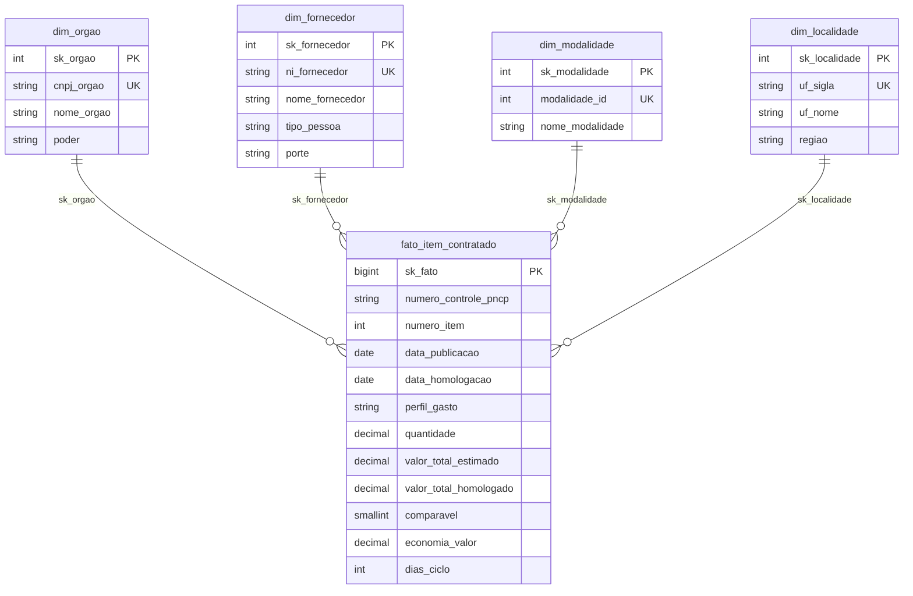
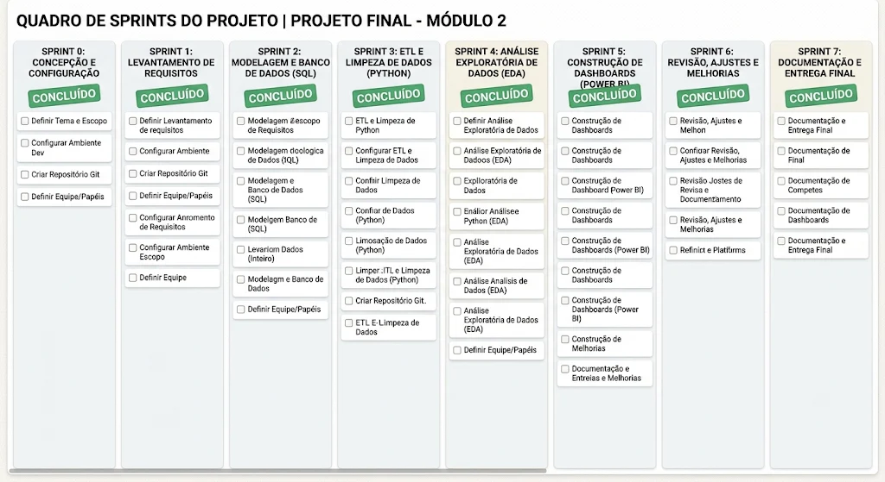

# Análise de Compras Públicas Federais (PNCP) — Esteira Analítica End-to-End

Projeto avaliativo do Módulo 2 (Análise de Dados com Python e PostgreSQL).
Esteira completa: **dados brutos do PNCP → Python (auditoria e limpeza) → PostgreSQL (Star Schema) → Power BI (dashboard executivo)**.

**Vídeo de apresentação:** _[COLE AQUI O LINK DO GOOGLE DRIVE]_

## 1. Contexto do problema

Uma consultoria de inteligência governamental atende órgãos de controle e transparência. A Controladoria identificou indícios de sobrepreço, concentração de contratos em poucos fornecedores, morosidade entre a publicação do edital e a homologação, e baixa competitividade em certas modalidades. Os dados de origem não têm validação na ponta: CNPJ com máscara, valores monetários em texto livre, datas em vários formatos e inconsistências de cronograma.

A base é o Portal Nacional de Contratações Públicas (PNCP), ano de 2025 completo (2.042 contratações, 7.077 itens e 15.896 resultados de fornecedores).

Perguntas de negócio respondidas: (1) economia global, (2) concentração de fornecedores, (3) eficácia por modalidade, (4) ciclo de compras por órgão, (5) distribuição regional e (6) perfil do gasto (bens, serviços, obras).

## 2. Estrutura do projeto

```
data/raw/        CSVs brutos fornecidos (compras, itens, resultados)
data/processed/  tabelas limpas geradas pelo Python (não versionadas)
src/             limpeza.py, montar_tabelas.py, carregar.py, banco.py, config.py, auditoria.py
sql/             01_criar_banco.sql e 02_perguntas.sql
powerbi/         dashboard_pncp.pbix
docs/img/        sprints.png e demais imagens
```

## 3. Decisões técnicas

- **Tudo como texto na leitura (`dtype=str`)**: o pandas não "ajuda" e o CNPJ não perde o zero à esquerda antes da limpeza.
- **Limpeza em funções pequenas e testáveis** (`src/limpeza.py`), com autoteste de 54 casos (`python -m src.limpeza`).
- **Separadores numéricos**: nesta base, ponto ou vírgula sozinho é sempre decimal; só o símbolo repetido é milhar. Evita volume inflado em bilhões.
- **Um vencedor por item**: primeiro descartam-se os resultados cancelados, depois fica o 1º colocado (menor ordem, desempate pelo menor sequencial). Se o 1º estiver cancelado, o 2º assume.
- **Só itens com resultado entram na fato** (852 itens sem resultado ficam de fora).
- **Itens rejeitados (99)**: quantidade ≤ 0 ou vazia, valor unitário estimado ou homologado ausente/≤ 0, orçamento sigiloso, total estimado < R$ 1, homologado mais de 1.000× o estimado, ou qualquer total acima de R$ 1 trilhão.
- **Comparabilidade**: item não é Credenciamento e a razão homologado ÷ estimado está entre 0,1 e 10. A economia só conta itens comparáveis, e o percentual é soma ÷ soma (nunca média de percentuais).
- **Cronologia**: homologação anterior à publicação é impossível; o item fica na fato, sem data de homologação e sem ciclo.
- **Perfil do gasto**: `material_ou_servico` define Bens/Serviços; palavras-chave (`obra`, `construção`, `reforma`, `engenharia`, com limites de palavra `\b`) no item ou no objeto da compra definem "Obras e engenharia".
- **Banco como segunda barreira**: `CHECK`, `UNIQUE` e `DECIMAL`.
- **Power BI com importação**, calendário dinâmico em DAX e 15 medidas explícitas.

## 4. Dicionário de inconsistências tratadas

Números obtidos pela auditoria (`python -m src.auditoria`).

| Desafio | Problema encontrado | Registros afetados | Tratamento |
|---|---|---|---|
| Documentos | CNPJ de órgão com máscara / com espaços nas pontas | 176 / 131 | mantém só dígitos, completa zeros (14 para PJ, 11 para PF) |
| Documentos | CNPJ/CPF de fornecedor com máscara / com espaços | 1.633 / 990 | idem, conforme `tipo_pessoa`; estrangeiros (PE) preservados |
| Documentos | CNPJ de órgão com 11, 12 ou 13 dígitos (zero perdido) | 77 | `zfill` até o tamanho correto |
| Dinheiro | Valores com `R$`, vírgula e ponto+vírgula misturados, espaços | ex.: 1.188 com `R$` em `valor_unitario_estimado` | `converter_numero` |
| Datas | 7 formatos diferentes no mesmo campo | `data_publicacao`: 7 formatos; `data_resultado`: 7 formatos | `converter_data` (2000–2030) |
| Nulos disfarçados | `N/A`, `-`, `0`, "Não se aplica" etc. | ex.: `categoria_item` 7.077; `porte` 4.893; `criterio_julgamento` 1.883; `modo_disputa` 967 | `eh_nulo` (o `0` só é nulo em texto) |
| Encoding | Texto UTF-8 lido como Latin-1 (`ç`, `ã`) | 173 em `objeto_compra`; 223 em `descricao`; 4 em `nome_fornecedor` | `consertar_acento` |
| Nomes | Mesmo órgão escrito de formas diferentes | 440 nomes distintos → 352 após padronizar | `padronizar_nome` (maiúsculas e espaços) |
| Regras | Resultados cancelados | 62 | descartados antes de escolher o vencedor |
| Regras | Itens com mais de um resultado (Registro de Preços) | 466 | um vencedor por item |
| Regras | Itens sigilosos | 54 | rejeitados |

## 5. Modelagem dimensional (Star Schema)



A fato tem uma linha por item de contratação (`numero_controle_pncp` + `numero_item`, único). O tempo é a tabela `Calendario`, criada em DAX no Power BI e relacionada a `data_publicacao` (ativa) e `data_homologacao` (inativa, usada com `USERELATIONSHIP`).

## 6. Tecnologias

Python 3.12 (pandas, psycopg2), PostgreSQL, SQL, Power BI Desktop (DAX), Git/GitHub.

## 7. Como reproduzir do zero

1. Clone o repositório e entre na pasta.
2. Crie o ambiente e instale as dependências:
   ```
   python -m venv .venv
   .venv\Scripts\Activate.ps1
   pip install -r requirements.txt
   ```
3. Copie `.env.example` para `.env` e preencha a senha do PostgreSQL.
4. Confira a limpeza: `python -m src.limpeza` (deve mostrar 54 de 54 exemplos certos).
5. Monte as tabelas: `python -m src.montar_tabelas` (imprime a conferência com a prova real).
6. Carregue o banco: `python -m src.carregar` (recria o banco, roda `sql/01_criar_banco.sql` e confere as contagens).
7. Rode as consultas de `sql/02_perguntas.sql` no pgAdmin.
8. Abra `powerbi/dashboard_pncp.pbix` e clique em **Atualizar**.

## 8. Resultados de conferência

| Indicador | Resultado |
|---|---|
| Itens na fato | 6.126 |
| Itens rejeitados | 99 |
| Fornecedores / órgãos (CNPJ) | 2.652 / 363 |
| Volume homologado | R$ 8.044.498.805,74 |
| Itens comparáveis | 5.457 |
| Economia | 14,46% |
| Ciclo médio / máximo | 48,1 / 611 dias |
| Itens sem ciclo | 230 |
| Perfil do gasto (volume) | Obras e engenharia 60,8% · Serviços 36,6% · Bens 2,6% |

## 9. Planejamento em Sprints



## 10. Melhorias futuras

- Orquestrar o pipeline (Python → banco) com um único comando e agendamento.
- Testes automatizados (pytest) para as regras de rejeição e comparabilidade.
- Classificação do perfil de gasto com mais termos e separação entre serviços continuados e eventuais.
- Tooltip e navegação por indicadores mais completos no dashboard.
- Ampliar o recorte temporal e consumir a API do PNCP diretamente.